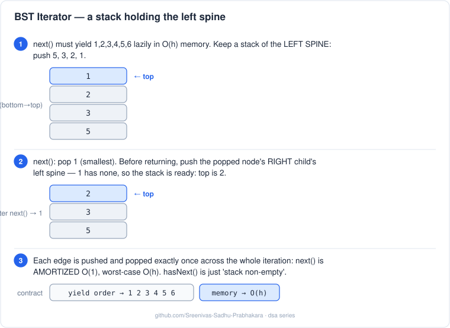

# BST Iterator

> Striver SDE Sheet 143 · Day 21 BST II — the iterative inorder traversal frozen mid-flight: the stack holds the left spine of whatever remains. Go, stdlib only, tested.

## Problem

An iterator over a BST yielding values in ascending order via `Next()`/`HasNext()`, using O(h) memory — not an upfront O(n) flatten.

## Approach

Take the iterative inorder traversal (#104) and store its loop state — the stack — in a struct, so each `Next()` performs exactly one iteration: pop a node, lazily push the left spine of its right subtree, return the value. `HasNext` is just a stack-emptiness check and consumes nothing. Although one `Next()` can push several nodes, each tree node is pushed and popped exactly once over the iterator's lifetime — amortized O(1) per call, the standard answer to the interviewer's follow-up. This object is the engine inside "two sum in BST with O(h) space" and k-way BST merges.

**Complexity:** Next amortized O(1), HasNext O(1), O(h) space.

## Visual walkthrough

Read the picture top to bottom — each numbered frame is one moment of the algorithm
running on this repo's test example.

## Run

    go test ./...   # verify
    go run .        # demo

---

One of 191 repos solving Striver's SDE Sheet in Go — stdlib only, one problem per repo, every solution tested. Browse the set: [`dsa-*` repos](https://github.com/Sreenivas-Sadhu-Prabhakara?tab=repositories&q=dsa-&type=source).
